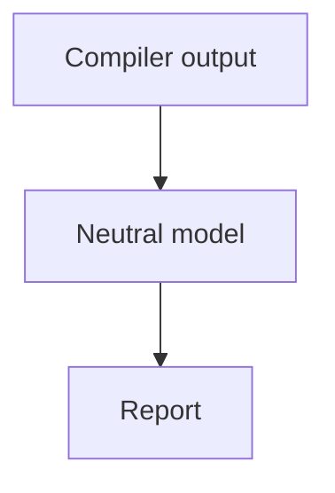
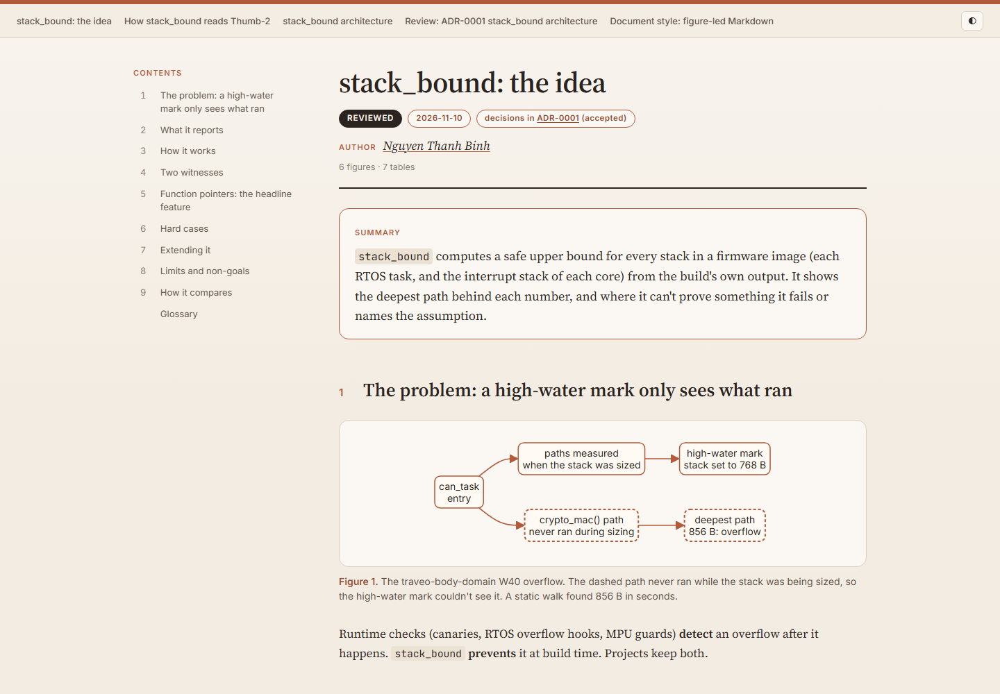

# claude-toolkit

Claude Code plugins by **Nguyen Thanh Binh**, built while developing an automotive embedded portfolio
and kept general enough for any project. Packaged as a plugin marketplace: install with one command,
update by version.

| Plugin | What it does | Version |
|---|---|---|
| [`figure-docs`](plugins/figure-docs) | Turns figure-led Markdown into report-style HTML or Claude Docs | 0.1.0 |

## figure-docs

Write engineering docs as Markdown with Mermaid figures and captioned tables; get a report.

**Before:** the Markdown in your repo.

````markdown
## 3. How it works



**Figure 3.** The pipeline. Everything below the model is toolchain-neutral.
````

**After:** the same page rendered by `figure-docs` (title block, author signature, summary panel,
contents sidebar, numbered figures; light and dark; Print → PDF gives an A4 report).



*Real output: the design docs of [stack_bound](https://github.com/binhnguyenthanh051-ops/stack_bound),
a static stack analyser for embedded firmware, are rendered with this plugin.*

| Skill | Use it for |
|---|---|
| `md-to-html-doc` | `.md` → self-contained HTML report (standard-library Python, no install) |
| `md-to-claude-doc` | `.md` → a commentable Claude Doc for review, re-synced when the Markdown changes |

The page style both follow is [`STYLE.md`](plugins/figure-docs/STYLE.md): lead with the answer,
number every section, let figures carry the argument.

## Install

In Claude Code:

```bash
/plugin marketplace add binhnguyenthanh051-ops/claude-toolkit
```

```bash
/plugin install figure-docs@binh-toolkit
```

Then ask, for example, "render docs/design.md as an HTML report". To sign your documents, create
`~/.claude/figure-docs.toml`:

```toml
[author]
name = "Your Name"
url = "https://github.com/you"
```

Without it, the author comes from `git config user.name`. Every page also carries a small
"Rendered with figure-docs by Nguyen Thanh Binh" credit (`--no-credit` removes it).

## Update

Releases bump the plugin's version (see [CHANGELOG](CHANGELOG.md)). Update with
`/plugin marketplace update binh-toolkit`, or turn on auto-update for the marketplace in `/plugin`.

## Develop

```bash
python -m pytest -q
```

```bash
claude plugin validate .
```

Design decisions: [ADR-0001](docs/adr/ADR-0001-toolkit.md). License: [MIT](LICENSE) © 2026 Nguyen
Thanh Binh.
