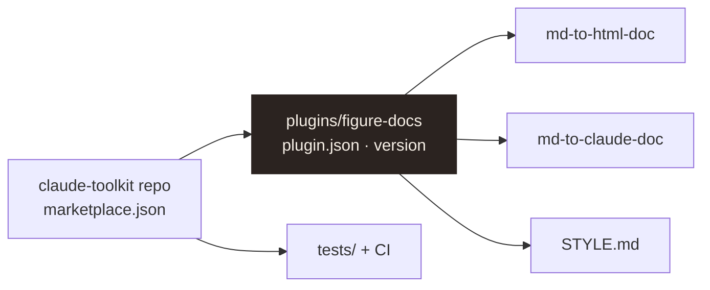

# ADR-0001: claude-toolkit as a plugin marketplace

**Status:** accepted · 2026-11-11 · applies to every plugin in this repo

**Summary.** General-purpose Claude Code skills live in one public repo, packaged as a plugin
marketplace, so they are versioned, tested, installable with one command, and updatable. Project-
specific skills stay in their projects.

## 1. Decisions



**Figure 1.** Repo layout. One marketplace, one plugin per theme, skills inside the plugin.

**Table 1.** Decisions and the alternatives rejected.

| Decision | Rejected alternative | Why |
|---|---|---|
| D1 Package as a plugin marketplace | A folder linked into `~/.claude/skills` | One-command install, versions, updates on other machines |
| D2 One plugin per theme (`figure-docs`) | One plugin per skill | Skills that share a style guide and assets ship together |
| D3 Standard library only (Python 3.11+) | A Markdown library | Nothing to install; deterministic output; the figure-led subset is small |
| D4 Markdown is the source of truth | Editing generated HTML or Docs | One place to change; outputs are rebuilt, never hand-edited |
| D5 Document author ≠ tool author | One signature for both | Users sign their own documents; the tool keeps a credit line |
| D6 Bump `version` on every release, tag `figure-docs--v<x.y.z>` | Track every commit | Users get deliberate releases; the changelog stays meaningful |

## 2. Developing

Add the marketplace from the local clone: Claude Code then loads the plugin from these files in
place, and edits apply after `/reload-plugins`, with no version bump.

```bash
claude plugin marketplace add C:/path/to/claude-toolkit
```

```bash
claude plugin install figure-docs@binh-toolkit
```
