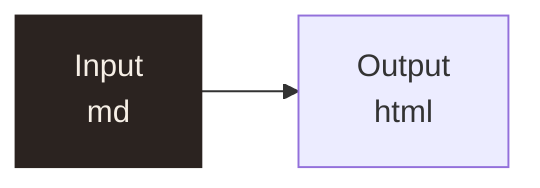

# Sample page

**Status:** draft · 2026-11-11 · see [other](other.md)

**Summary.** The converter keeps every figure, table and caption, and escapes `<raw>` text.

## 1. Pipeline



**Figure 1.** The pipeline, two boxes.

**Table 1.** Values with an escaped \| pipe.

| Name | Value |
|---|---|
| **Group** ||
| a \| b | `x|y` |

### D1. A decision

```armasm
10086742  stmdb  sp!, {r4, lr}   @ push 2 registers
```

> **Note.** A callout with a [link](https://example.com).

- one *item*
- two **items**

Related: [repo file](../src/main.c)
